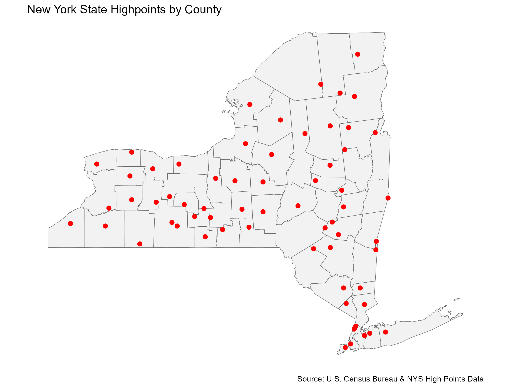
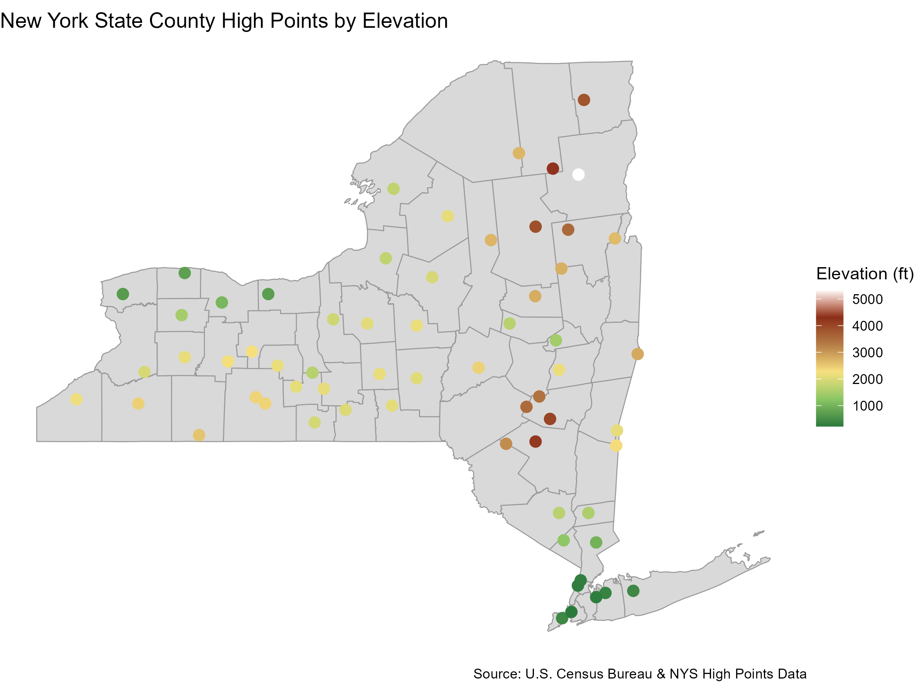
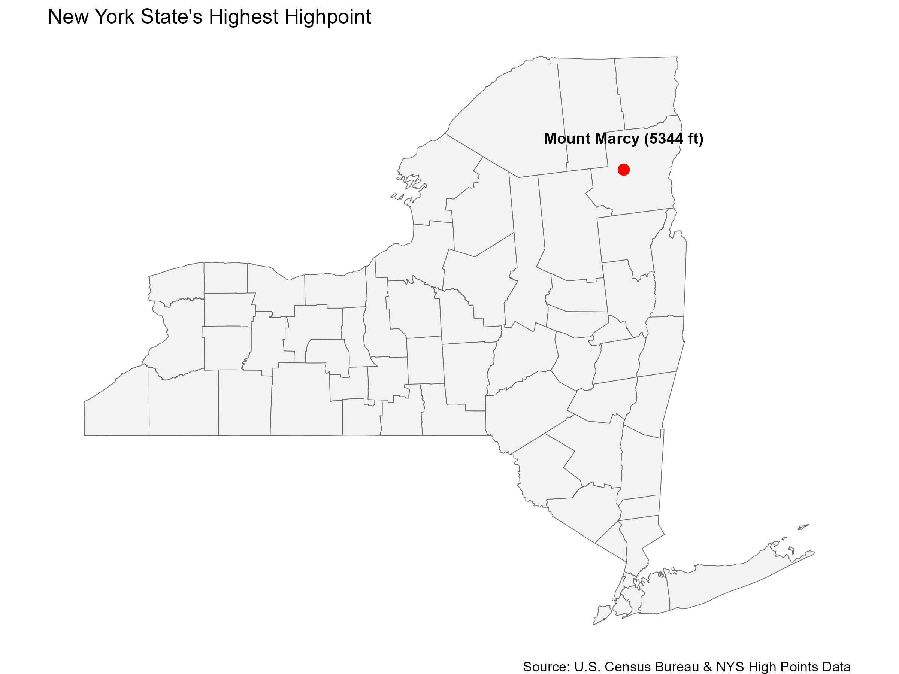
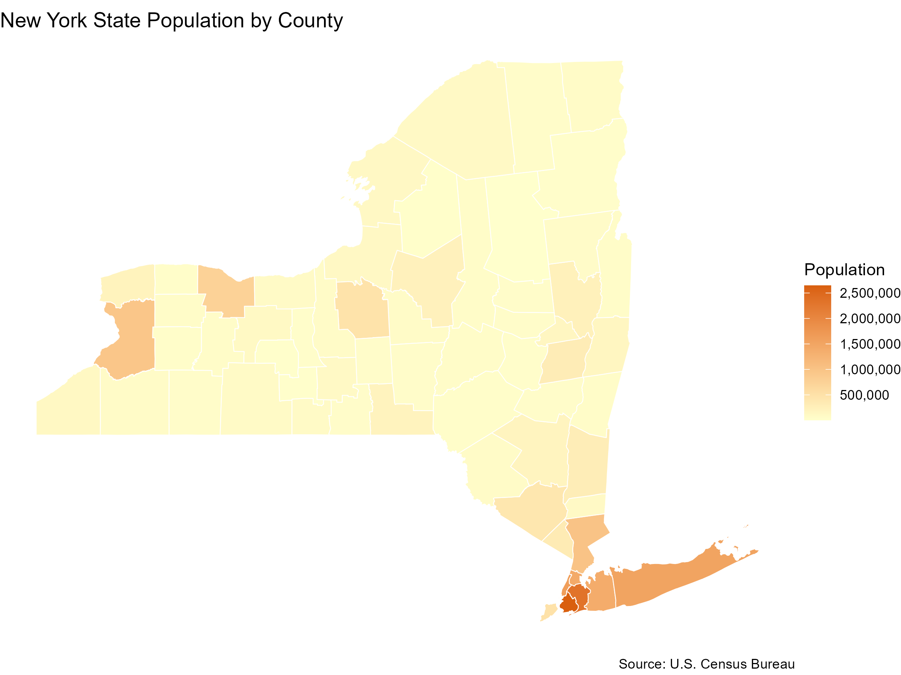
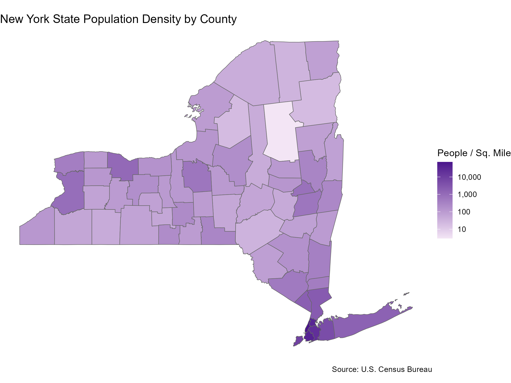

```{r setup}
#| include: false
# Optional: Run master.R if you want the Quarto doc to execute your pipeline fresh,
# leave this commented out if your PNGs are already generated in output/
# source("master.R")
```

## 1. New York State Counties & High Points

To examine New York's geography, U.S. Census county boundary shapefiles (`cb_2024_us_county_500k.shp`) were filtered to New York State (`STATEFP == "36"`) and layered with county high-point coordinates.

{width=85%}

### Elevation Distribution
Using a cartographic hypsometric elevation scale (green for low-lying valleys, yellow/brown for mid-elevations, and red/white for high peaks), the highest elevations cluster in the Adirondack and Catskill regions.

{width=85%}

### Highest and Lowest County High Points
* **Highest Point:** Mount Marcy (Essex County) at **5,344 feet**.
* **Lowest County High Point:** Battle Hill (Queens County) at **220 feet**.


{width=85%}

\newpage

## 2. County Area, Population, and Density

County-level population data was retrieved via the `tidycensus` package and joined to the Census spatial layer by `GEOID`. Land area (`ALAND`) was converted from square meters to square miles to compute population density.

### Key Summary Findings
* **Largest County by Land Area:** St. Lawrence County (~2,680 sq. miles)
* **Smallest County by Land Area:** New York County / Manhattan (~22.7 sq. miles)
* **Most Populous County:** Kings County / Brooklyn (~2.6M+ residents)
* **Least Populous County:** Hamilton County (~5,100 residents)
* **Most Densely Populated County:** New York County / Manhattan (~72,000+ people/sq. mile)
* **Least Densely Populated County:** Hamilton County (~3 people/sq. mile)

{width=85%}

{width=85%}
